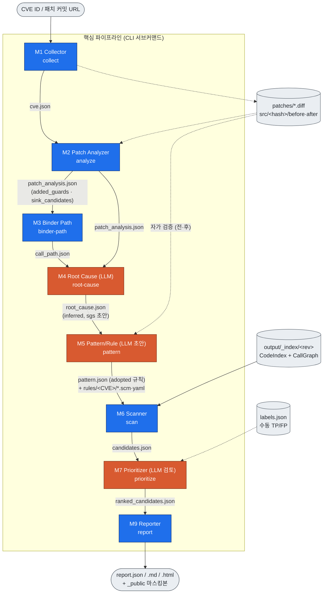
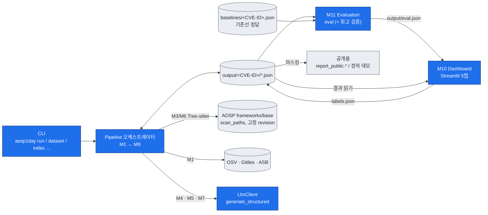
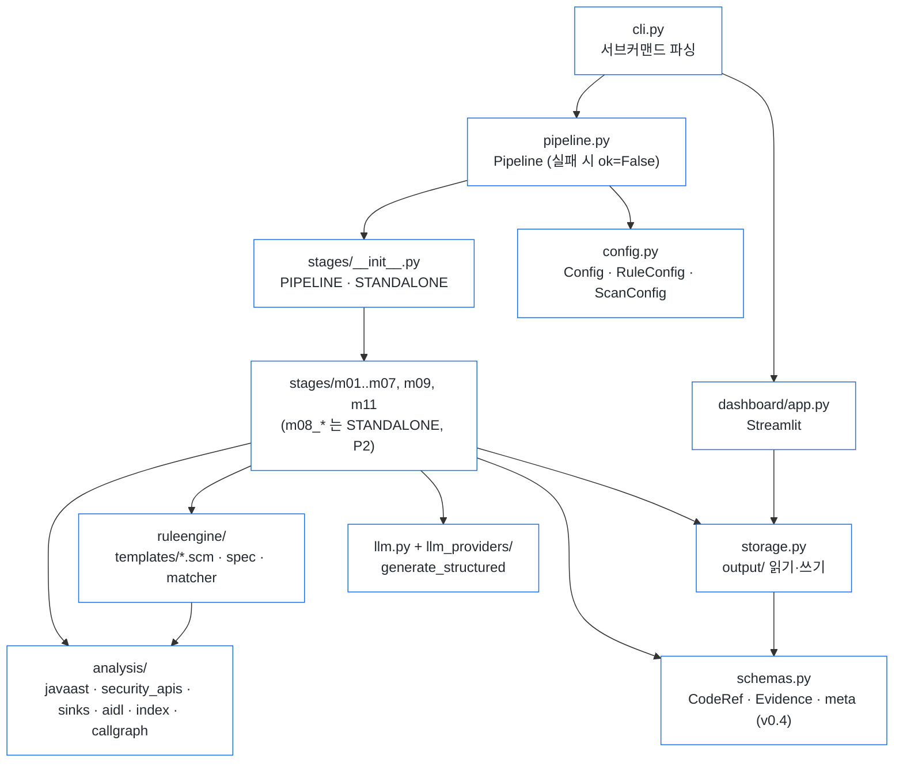
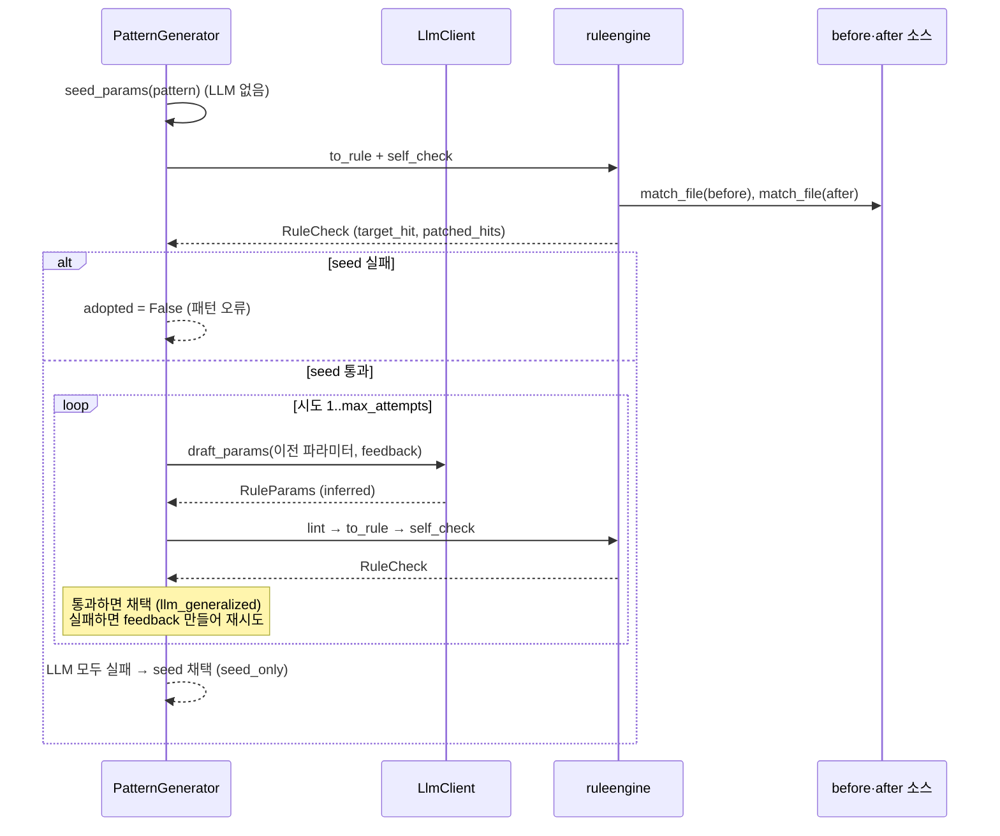
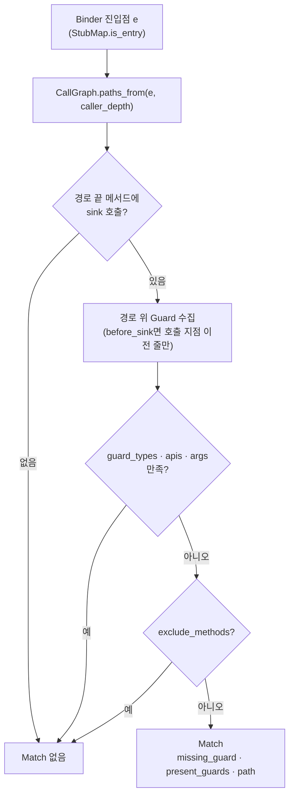
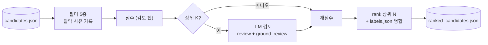

# 시스템 구조도 (v2)

설계 뼈대(`aosp1day/`)와 v2 목표(공개 패치의 Source–Guard–Sink 구조로 다른 System Service의 변종 후보 탐지)를 Mermaid로 나타낸 것이다.
클래스·메서드 상세는 [design.md](design.md), 기능 ID는 [feature-spec.md](feature-spec.md), 데이터 계약은 [`aosp1day/schemas.py`](../aosp1day/schemas.py) 참고.

## 1. 파이프라인 단계와 산출물 (M1 → M9)

각 단계는 `output/<CVE-ID>/*.json` 으로만 연결되고, 앞 단계 JSON만 있으면 독립 실행된다.
모든 산출물은 `meta`(스키마 버전·생성 시각·입력 해시)를 가지고, 코드 위치는 전부 `CodeRef`(revision·side·줄 범위·snippet)로 표현한다.

실행 순서는 `collect → analyze → binder-path → root-cause → pattern → scan → prioritize → report`. `run`은 한 단계가 실패해도 입력이 준비된 단계는 계속 실행한다. M8(Harness·Verifier)은 P2로 `PIPELINE`에서 빠졌다.

주황색 단계만 LLM을 쓴다. LLM 출력은 항상 결정적 검사(근거 대조, 규칙 자가 검증, 근거 줄 확인)를 거친다.

## 2. 전체 시스템 (대시보드 · 평가 포함)

대시보드(M10)는 Streamlit 단독이며 별도 Backend API·작업 큐가 없다. 미리 생성된 JSON만 읽고, 쓰는 것은 수동 라벨(`labels.json`)뿐이다.

## 3. 코드 뼈대 매핑 (`aosp1day/`)

## 4. M5 규칙 채택 루프

## 5. RuleMatcher 판정 (진입점 하나 기준)

## 6. M7 후보 선별

