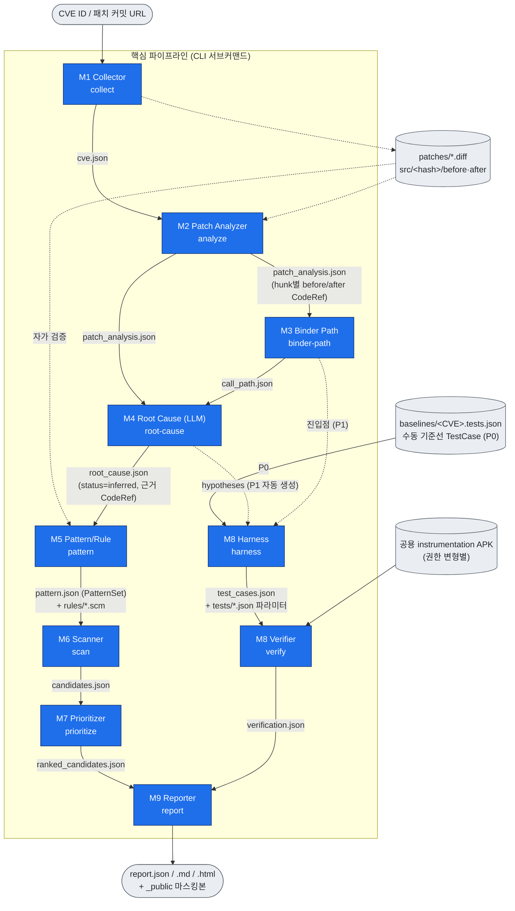
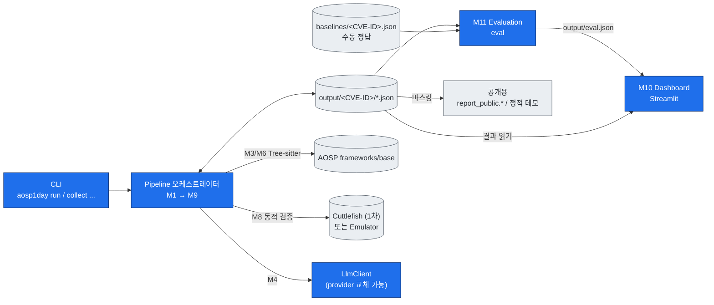
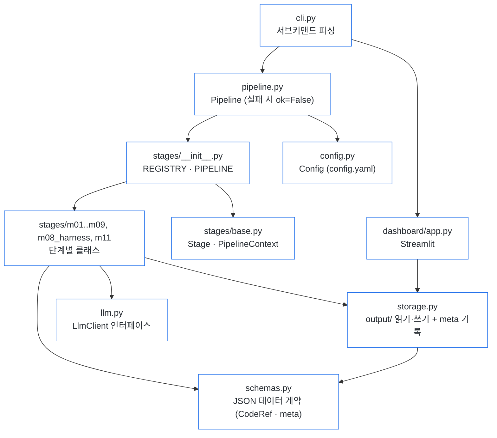

# 시스템 구조도

PR #20의 모듈 구성(M1~M11)과 설계 뼈대(`aosp1day/`)를 Mermaid로 나타낸 것이다.
기능 상세는 [feature-spec.md](feature-spec.md), 데이터 계약은 feature-spec 4장과 [`aosp1day/schemas.py`](../aosp1day/schemas.py) 참고.

## 1. 파이프라인 단계와 산출물 (M1 → M9)

각 단계는 `output/<CVE-ID>/*.json` 으로만 연결되고, 앞 단계 JSON만 있으면 독립 실행된다.
모든 산출물은 `meta`(스키마 버전·생성 시각·입력 해시)를 가지고, 코드 위치는 전부 `CodeRef`(revision·file·side·줄 범위·snippet)로 표현한다. `revision`은 그 코드가 실제로 있는 커밋(before=parent, after=패치 커밋)이다.

실행 순서는 `collect → analyze → binder-path → root-cause → harness → verify → pattern → scan → prioritize → report`. 기준선 검증(Harness·Verifier)을 전체 스캔보다 먼저 두고, `run`은 한 단계가 실패해도 입력이 준비된 단계는 계속 실행한다.

## 2. 전체 시스템 (대시보드 · 평가 포함)

대시보드(M10)는 Streamlit 단독이며 별도 Backend API·작업 큐가 없다. 미리 생성된 JSON만 읽는다.

## 3. 코드 뼈대 매핑 (`aosp1day/`)

