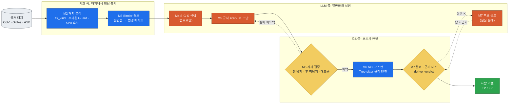
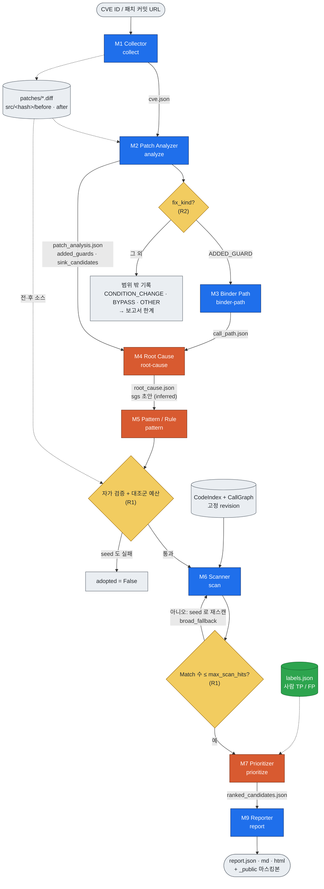
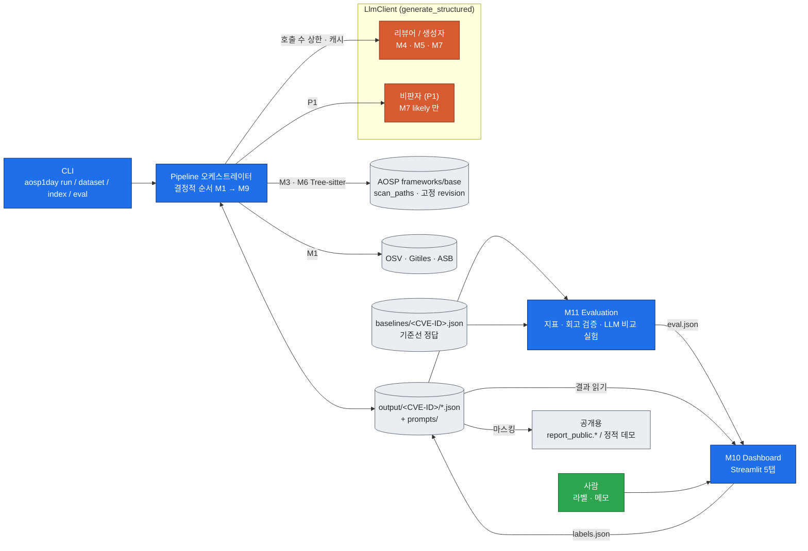
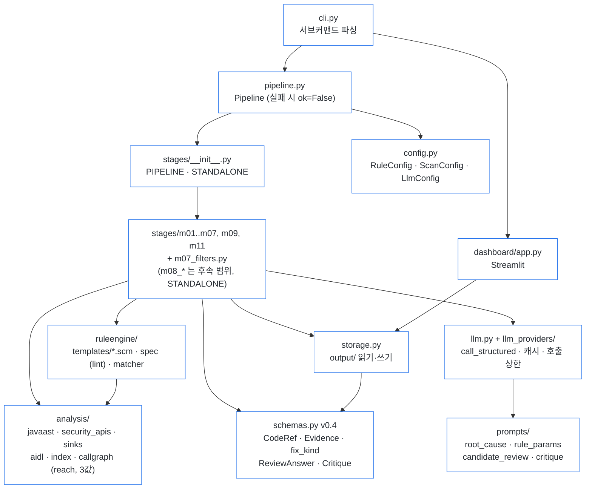
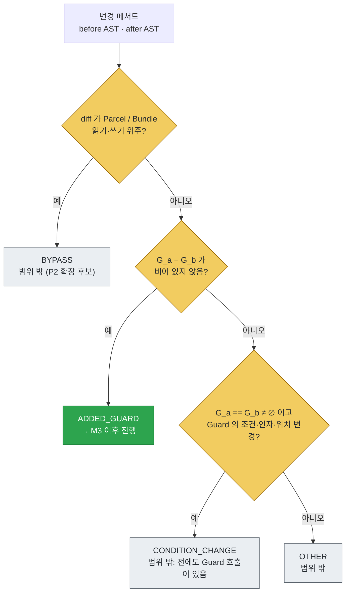
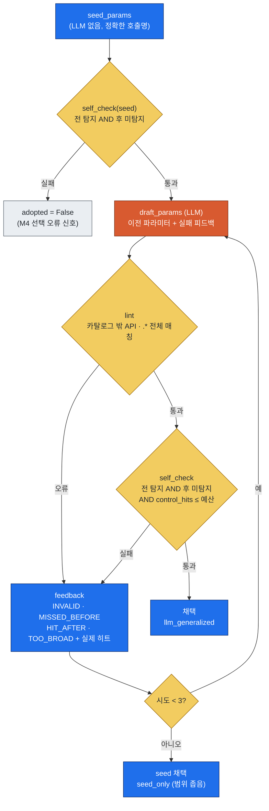
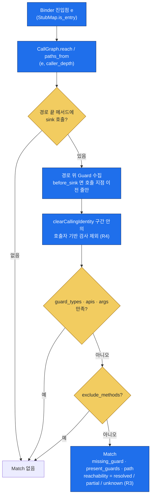
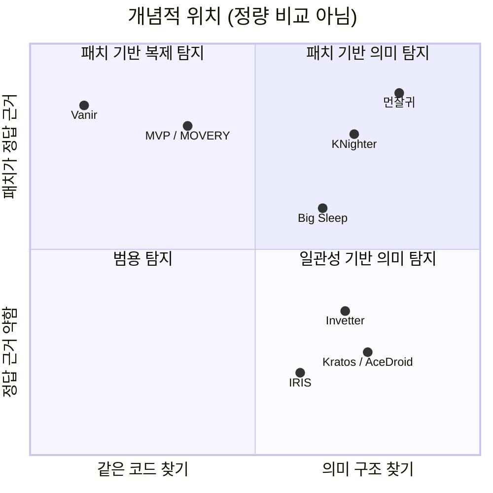

# 시스템 구조도 (v2.2)

> 2026-11-23 · 김나연 · v2 구조도에 v2.1 실현 가능성 수정(R1~R5)과 v2.2 LLM 검증 구조를 반영
> 클래스·메서드 상세는 [design.md](design.md), LLM 사용·검증의 근거는 [llm-verification.md](llm-verification.md), 기능 ID는 [feature-spec.md](feature-spec.md), 데이터 계약은 [`aosp1day/schemas.py`](../aosp1day/schemas.py) 참고.
> 각 구성 요소가 어디서 왔는지는 [8. 참고한 연구·도구](#8-참고한-연구도구와-구성-요소의-출처)에 정리했다.

**색 규칙 (모든 그림 공통)** — 파랑: 결정적 코드 · 주황: LLM · 노랑: 판정(게이트) · 초록: 사람 · 회색: 파일·외부 데이터

---

## 0. 한눈에 보기 — 신경·기호 결합(neuro-symbolic) 구조

패치가 "이 Sink 에는 이 Guard 가 필요하다"는 정답을 주고(기호), LLM 은 그 정답을 **규칙으로 일반화**하고 **애매한 후보를 설명**하는 데만 쓴다(신경). 스캔과 채택·탈락 판정은 결정적 코드가 한다. KNighter [L1]·IRIS [L2] 가 보인 "LLM 은 분석기를 만들거나 보조하고, 큰 코드베이스 스캔은 정적 분석기가 한다"는 구조를 Android Framework 권한 검사 문제에 맞춘 것이다.

---

## 1. 파이프라인 단계와 산출물 (M1 → M9)

각 단계는 `output/<CVE-ID>/*.json` 으로만 연결되고, 앞 단계 JSON 만 있으면 독립 실행된다. 모든 산출물은 `meta`(스키마 버전·생성 시각·입력 해시)를 가지고, 코드 위치는 전부 `CodeRef`(revision·side·줄 범위·snippet)로 표현한다. 실행 순서는 `collect → analyze → binder-path → root-cause → pattern → scan → prioritize → report`. M8(Harness·Verifier, 동적 재현)은 **후속 범위**로 이번 프로젝트에서 제외돼 `PIPELINE` 에 없다.

v2.1 에서 노랑 게이트 세 개가 추가됐다: M2 의 수정 유형 분기(R2), M5 의 대조군 예산(R1), M6 의 스캔 예산(R1).

---

## 2. 전체 시스템 (대시보드 · 평가 포함)

대시보드(M10)는 Streamlit 단독이며 별도 Backend API·작업 큐가 없다. 미리 생성된 JSON 만 읽고, 쓰는 것은 수동 라벨(`labels.json`)뿐이다. LLM 은 리뷰어와 (P1) 비판자 두 역할로 나뉘고, 비판자는 가능하면 다른 계열 모델을 쓴다([llm-verification.md](llm-verification.md) 3.3).

---

## 3. 코드 뼈대 매핑 (`aosp1day/`)

---

## 4. M2 수정 유형 분기 (R2)

"Guard 누락" 규칙으로 패치 전·후를 구분할 수 있는 패치만 이후 단계로 보낸다. 변경 메서드마다 패치 전·후의 Guard **유형 집합**(`G_b`, `G_a`)을 비교한다.

---

## 5. M5 규칙 채택 루프 (R1 반영)

LLM 은 고정 템플릿의 **파라미터만** 만들고, 채택은 실행 결과가 정한다. KNighter [L1] 의 "패치로부터 합성 → 원본 패치로 검증 → 정제" 구조를 축소한 것이며, 피드백은 항상 실행 결과다(외부 피드백 없는 자기 수정은 쓰지 않음 [L5]). 상세는 [llm-verification.md 3.2](llm-verification.md#32-m5--실행-오라클-기반-생성정제-루프).

---

## 6. RuleMatcher 판정 (R3·R4 반영, 진입점 하나 기준)

Guard 는 호출자 신원(Binder calling uid)에 기대는 경우가 많고, `clearCallingIdentity` 이후에는 호출자가 system 으로 바뀌어 그런 검사가 항상 통과한다. 또 Android Framework 에서는 권한 검사가 민감 동작과 다른 메서드에 있는 경우가 흔하다(Axplorer 의 permission locality 분석 [S1]). 그래서 경로 전체에서 Guard 를 모으되, identity 해제 구간 안의 호출자 기반 검사는 세지 않는다.

---

## 7. M7 후보 선별 (R3·R5 + v2.2 검증 계층)

필터는 해석 못 한 호출 때문에 확정할 수 없는 후보를 떨어뜨리지 않고 `unknown` 으로 남겨 감점만 한다(R3). LLM 은 사실 질문 3개에만 답하고 판정은 코드가 계산하며, 그 결과는 점수의 `review` 항에만 반영된다(R5). 상세와 근거 문헌은 [llm-verification.md 3.3](llm-verification.md#33-m7--질문-분해--코드-판정--교차-비판).

```mermaid
flowchart LR
    C[("candidates.json")]:::io --> F["필터 5종<br/>pass / unknown / 탈락 사유"]:::code
    F --> S1["점수 (검토 전)<br/>conf: resolved 1.0 · partial 0.7 · unknown 0.4"]:::code
    S1 --> K{"상위 K?"}:::gate
    K -- 예 --> R["리뷰어 LLM<br/>q_guard · q_alt_check · q_reach"]:::llm
    R --> G["근거 대조 → derive_verdict"]:::gate
    G -- likely --> CR["비판자 LLM (P1)<br/>다른 계열 우선"]:::llm
    CR --> G2{"근거 있는 반박?"}:::gate
    G2 -- 예 --> U["unsure 로 낮춤"]:::code
    G2 -- 아니오 --> S2
    U --> S2
    G -- "unlikely / unsure" --> S2
    K -- 아니오 --> S2["재점수<br/>review 항만 변경"]:::code
    S2 --> RK["rank 상위 N<br/>+ labels.json 병합"]:::code
    RK --> O[("ranked_candidates.json")]:::io
    O --> HU["사람 라벨 (최종)"]:::human
    classDef code fill:#1f6feb,stroke:#0b2a66,color:#fff;
    classDef llm fill:#d85a30,stroke:#712b13,color:#fff;
    classDef gate fill:#f2cc60,stroke:#9a6700,color:#24292f;
    classDef human fill:#2da44e,stroke:#116329,color:#fff;
    classDef io fill:#eaeef2,stroke:#57606a,color:#24292f;
```

---

## 8. 참고한 연구·도구와 구성 요소의 출처

### 8.1 구성 요소별 출처

| 우리 구성 요소 | 무엇을 가져왔나 | 참고 |
| --- | --- | --- |
| 전체 구조: 패치 → 규칙 → 대규모 스캔 | LLM 이 코드를 직접 다 읽지 않고, 과거 패치로부터 **정적 체커**를 만들어 스캔하게 함. 원본 패치로 체커를 검증해 환각을 줄임 | KNighter [L1] |
| LLM 은 명세 추론·맥락 분석, 탐지는 정적 분석기 | LLM 이 source·sink 명세를 추론하고 CodeQL 이 탐지, 결과를 LLM 맥락 분석으로 거름 | IRIS [L2] |
| "취약 시그니처는 맞고 패치 시그니처는 안 맞는" 판정 | 패치 전 탐지·패치 후 미탐지를 규칙 채택 조건으로 사용 | MVP [S5] (반복 취약점 탐지) |
| Source–Guard–Sink 구조, Guard 유형 정규화 | 서비스 진입점에서 민감 동작까지 경로의 보안 검사를 유형으로 묶어 비교 | Invetter [S4], AceDroid [S3], Kratos [S2], ACMiner [S6] |
| 경로 전체에서 Guard 수집 (`caller_depth`) | 프레임워크의 권한 검사는 민감 동작과 다른 위치에 있는 경우가 많음(permission locality) | Axplorer [S1] |
| `@EnforcePermission`·identity 해제 구간 처리 | Android 고유의 권한 강제·호출자 신원 규칙 | AOSP 소스 규약 (Binder `clearCallingIdentity`, `@EnforcePermission` 코드 생성) |
| M7 질문 분해·코드 판정 | 분석을 하위 과제로 쪼개 각 답을 검증 | LLift [L3], LLMDFA [L4], GitHub Security Lab Taskflow [L12] |
| M5 실패 피드백 재생성 | 외부(실행) 피드백 기반 정제만 사용 | Huang et al. [L5], KNighter [L1] |
| M4 표본 일치도 | 여러 표본의 최빈 답, 불일치를 불확실성 신호로 | Self-Consistency [L6] |
| M7 비판자 (교차 모델) | 생성·판별 분리, 판별자는 다른 계열 모델 | GPTLens [L8], 다중 에이전트 토론 [L7], 자기 선호 편향 [L9] |
| 사람 라벨 재사용 | 사람 분류 결정을 이후 자동 분류에 반영 | Semgrep Assistant [L11] |
| 결정적 파이프라인 오케스트레이션 | 자율 에이전트 대신 단계 고정. 이전 패치를 출발점으로 한 LLM 변종 분석 사례는 참고 | Big Sleep [L10] |
| 탐지 대상 범위 구분 | 패치 누락(같은 코드) 판정은 기존 도구 영역 | Vanir [S7] |

### 8.2 기존 접근과의 위치

위 그림은 각 접근이 무엇을 정답 근거로 삼고 무엇을 찾는지에 대한 **개념적 배치**다. 우리 프로젝트는 KNighter 와 같은 "패치 기반 의미 탐지" 영역에 있으면서, 대상을 Android Framework 권한 검사(Binder 진입점·Guard 유형)로 특화한 것이 차이다.

### 8.3 참고 문헌

LLM 관련 [L*] 은 [llm-verification.md 참고 문헌](llm-verification.md#참고-문헌)과 같은 번호다. 모두 2026-11-23 에 확인했다.

**LLM·분석 결합**

- [L1] C. Yang et al., "KNighter: Transforming Static Analysis with LLM-Synthesized Checkers," SOSP 2025. https://arxiv.org/abs/2503.09002
- [L2] Z. Li, S. Dutta, M. Naik, "IRIS: LLM-Assisted Static Analysis for Detecting Security Vulnerabilities," ICLR 2025. https://arxiv.org/abs/2405.17238
- [L3] H. Li, Y. Hao, Y. Zhai, Z. Qian, "Enhancing Static Analysis for Practical Bug Detection: An LLM-Integrated Approach (LLift)," OOPSLA 2024. https://arxiv.org/abs/2308.00245
- [L4] C. Wang et al., "LLMDFA: Analyzing Dataflow in Code with Large Language Models," NeurIPS 2024. https://arxiv.org/abs/2402.10754
- [L5] J. Huang et al., "Large Language Models Cannot Self-Correct Reasoning Yet," ICLR 2024. https://arxiv.org/abs/2310.01798
- [L6] X. Wang et al., "Self-Consistency Improves Chain of Thought Reasoning in Language Models," ICLR 2023. https://arxiv.org/abs/2203.11171
- [L7] Y. Du et al., "Improving Factuality and Reasoning in Language Models through Multiagent Debate," ICML 2024. https://arxiv.org/abs/2305.14325
- [L8] S. Hu et al., "Large Language Model-Powered Smart Contract Vulnerability Detection: New Perspectives (GPTLens)," IEEE TPS 2023. https://arxiv.org/abs/2310.01152
- [L9] A. Panickssery, S. R. Bowman, S. Feng, "LLM Evaluators Recognize and Favor Their Own Generations," NeurIPS 2024. https://arxiv.org/abs/2404.13076
- [L10] Google Project Zero · DeepMind, "From Naptime to Big Sleep," 2024. https://projectzero.google/2024/10/from-naptime-to-big-sleep.html
- [L11] Semgrep, "Semgrep Assistant overview." https://semgrep.dev/docs/semgrep-assistant/overview
- [L12] GitHub Security Lab, "AI-supported vulnerability triage with the GitHub Security Lab Taskflow Agent." https://github.blog/security/ai-supported-vulnerability-triage-with-the-github-security-lab-taskflow-agent/

**Android Framework 보안 분석·패치 기반 탐지**

- [S1] M. Backes, S. Bugiel, E. Derr, P. McDaniel, D. Octeau, S. Weisgerber, "On Demystifying the Android Application Framework: Re-Visiting Android Permission Specification Analysis (Axplorer)," USENIX Security 2016. https://www.usenix.org/conference/usenixsecurity16/technical-sessions/presentation/backes_android
- [S2] Y. Shao, Q. A. Chen, Z. M. Mao, J. Ott, Z. Qian, "Kratos: Discovering Inconsistent Security Policy Enforcement in the Android Framework," NDSS 2016.
- [S3] Y. Aafer et al., "AceDroid: Normalizing Diverse Android Access Control Checks for Inconsistency Detection," NDSS 2018. https://doi.org/10.14722/ndss.2018.23121
- [S4] L. Zhang et al., "Invetter: Locating Insecure Input Validations in Android Services," ACM CCS 2018. https://doi.org/10.1145/3243734.3243843
- [S5] Y. Xiao et al., "MVP: Detecting Vulnerabilities using Patch-Enhanced Vulnerability Signatures," USENIX Security 2020. https://www.usenix.org/conference/usenixsecurity20/presentation/xiao · 후속: MOVERY (USENIX Security 2022), FIRE (USENIX Security 2024)
- [S6] S. A. Gorski III et al., "ACMiner: Extraction and Analysis of Authorization Checks in Android's Middleware," CODASPY 2019. https://arxiv.org/abs/1901.03603
- [S7] Google, "Vanir: Missing Patch Scanner." https://github.com/google/vanir
