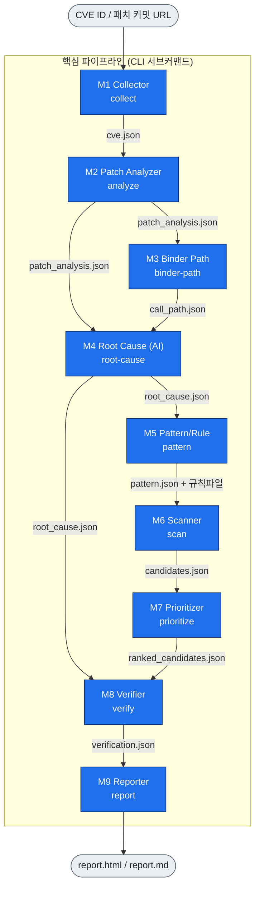
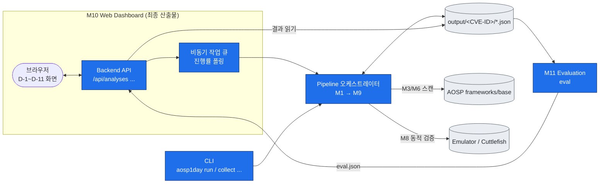
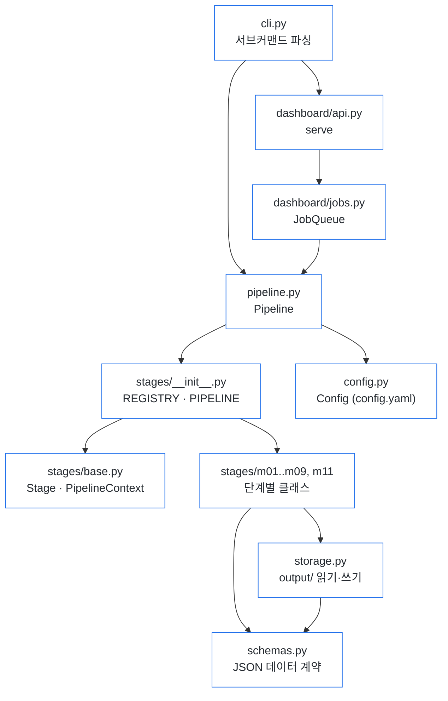

# 시스템 구조도

PR #20에서 확정한 모듈 구성(M1~M11)과 설계 뼈대(`aosp1day/`)를 Mermaid로 나타낸 것이다.
기능 상세는 [feature-spec.md](feature-spec.md), 주차 계획은 [roadmap.md](roadmap.md) 참고.

## 1. 파이프라인 단계와 산출물 (M1 → M9)

각 단계는 `output/<CVE-ID>/*.json` 으로만 연결되고, 앞 단계 JSON만 있으면 독립 실행된다.

## 2. 전체 시스템 (대시보드 · 평가 포함)

`output/<CVE-ID>/*.json` 을 중심으로 CLI, 대시보드(M10), 평가(M11)가 붙는다.

## 3. 코드 뼈대 매핑 (`aosp1day/`)

