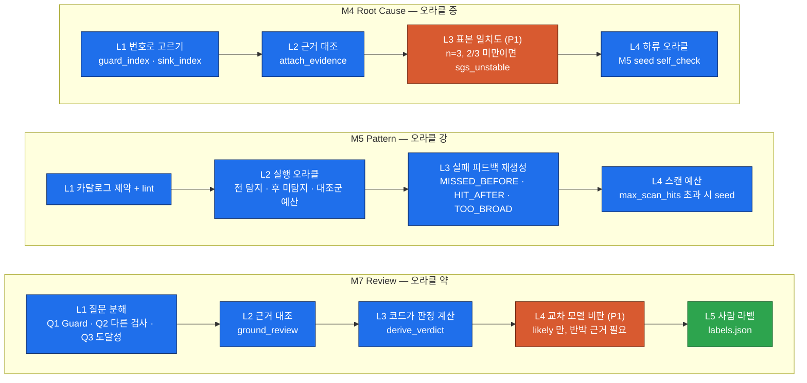
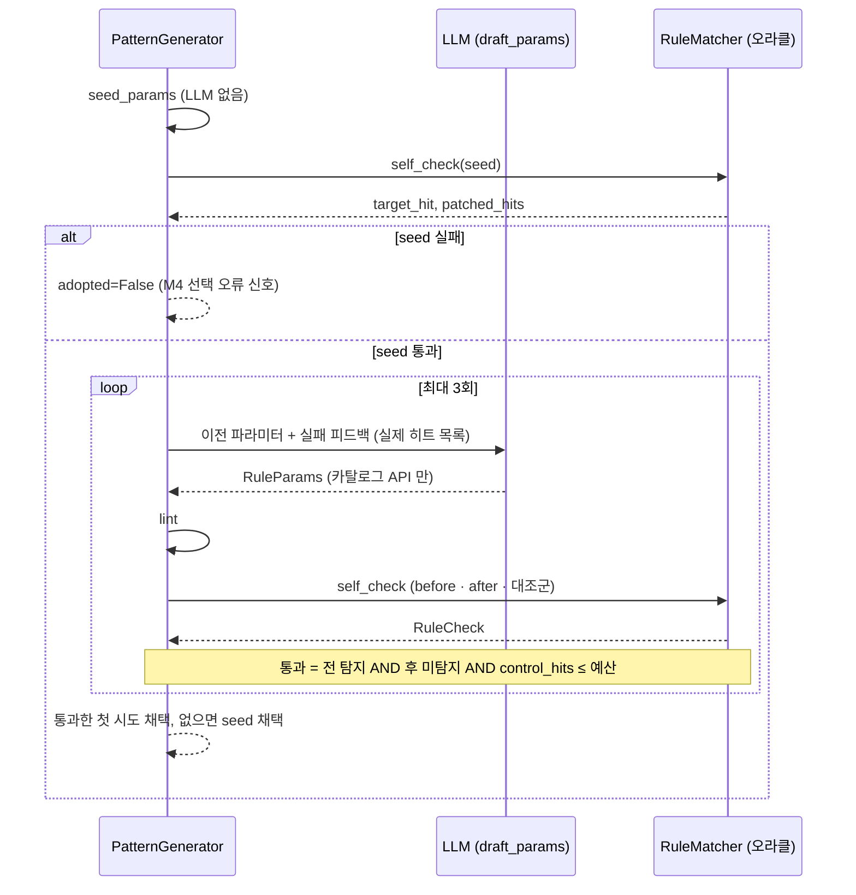
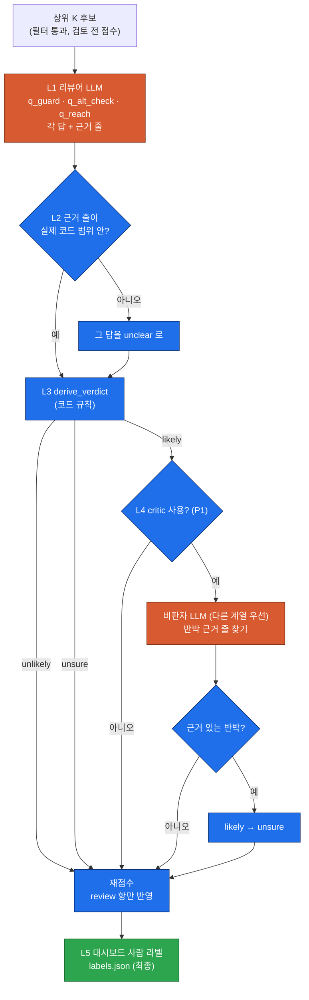

# LLM 사용·검증 구조 (v2.2)

> 2026-11-23 · 김나연
> 대상: M4 Root Cause · M5 Pattern/Rule · M7 Prioritizer 의 LLM 호출
> 관련 문서: [architecture.md](architecture.md) (전체 구조도) · [design.md](design.md) (클래스·메서드 명세) · 참고 문헌은 이 문서 끝 [참고 문헌](#참고-문헌)

이 문서는 "LLM 을 어디에, 왜, 어떻게 검증하며 쓰는가"를 선행 연구와 도구에 비추어 정리한다. 다중 LLM 토론처럼 무거운 기법을 그대로 들여오지 않고, **우리 문제에서 외부 오라클(코드로 판정 가능한 근거)이 얼마나 강한지**에 맞춰 필요한 만큼만 검증 계층을 쌓는 것이 기본 방침이다.

---

## 1. 설계 원칙 다섯 가지(A~E)와 출처

아래에서 P0·P1·P2 는 구현 우선순위(이번 범위·시간 되면·이후)를 뜻한다.

| # | 원칙 | 우리 구조에서의 형태 | 참고한 것 |
| --- | --- | --- | --- |
| A | **LLM 은 분석기를 만들고, 스캔은 결정적 엔진이 한다** | M5 의 LLM 은 규칙 파라미터만 만든다. AOSP 전체 스캔(M6)은 Tree-sitter 규칙 엔진이 한다 | KNighter [1] (패치로부터 정적 체커 합성), IRIS [2] (LLM 이 taint 명세 추론, CodeQL 이 탐지) |
| B | **자기 반성보다 외부 피드백** | M5 재시도 때 "다시 생각해 봐"가 아니라 규칙을 실제 코드에 돌린 결과(놓친 줄·잘못 잡은 메서드)를 돌려준다 | Huang et al. [5] (외부 피드백 없는 자기 수정은 추론을 개선하지 못함), KNighter [1] (원본 패치로 체커 검증) |
| C | **좁은 질문으로 쪼개고, 답은 코드에 묶는다** | M4 는 후보 번호로만 고르고, M7 은 질문 3개를 따로 답하게 한 뒤 **판정은 코드가 계산**한다. 근거 줄은 실제 코드와 대조한다 | LLift [3] (프롬프트 전략·하위 과제 분해), LLMDFA [4] (하위 문제 분해·검증으로 환각 완화), GitHub Security Lab Taskflow [12] (큰 프롬프트 하나 대신 작은 태스크) |
| D | **생성과 판별을 분리하고, 판별자는 다른 모델로** | M7 에서 "likely" 후보만 비판자(critic)가 반박 근거를 찾는다. 가능하면 다른 계열 모델을 쓴다 | GPTLens [8] (auditor–critic 2단계), Panickssery et al. [9] (LLM 평가자의 자기 선호 편향), Du et al. [7] (다중 에이전트 토론 — 비용 때문에 1라운드로 축소) |
| E | **불확실하면 표시하고, 사람이 닫는다** | 근거가 안 맞으면 `unsure`, 표본끼리 답이 갈리면 `sgs_unstable`. 사람 라벨이 최종이고 다음 실행에 반영된다 | Wang et al. [6] (self-consistency, 표본 간 일치도), Semgrep Assistant [11] (사람 분류 결정을 기억해 재사용) |

> 오케스트레이션 방식: **결정적 파이프라인이 LLM 을 부른다.** LLM 이 다음에 무엇을 할지 고르는 자율 에이전트(Big Sleep [10] 류)는 쓰지 않는다. 결과 재현, CVE 당 호출 수 상한, 단계별 평가가 가능해야 하기 때문이다. 대신 에이전트 연구에서 쓰는 역할 분리(생성자·비판자), 외부 도구 피드백, 표본 일치도는 단계 안에서 빌려 쓴다.

---

## 2. 검증 강도 배치: 오라클이 약한 곳에 검증을 더 쌓는다

| LLM 호출 | LLM 이 만드는 것 | 외부 오라클 (코드로 판정) | 오라클 강도 | 그래서 쌓는 검증 |
| --- | --- | --- | --- | --- |
| M4 `root-cause` | S·G·S 선택(번호), 원인 설명 | 다음 단계 M5 seed 규칙의 자가 검증 (잘못 고르면 seed 가 실패) | 중 | 번호 선택 + 근거 대조 + (P1) 표본 일치도 |
| M5 `pattern` | 규칙 파라미터 | 패치 전 탐지·후 미탐지·대조군 예산 (실행 결과) | **강** | 카탈로그 제약 + 실행 오라클 + 실패 피드백. LLM 판정자 불필요 |
| M7 `prioritize` | 후보가 진짜인지에 대한 판단 | 없음 (정답은 사람 검토) | **약** | 질문 분해 + 근거 대조 + 코드 판정 + (P1) 교차 모델 비판 + 사람 라벨 |

M5 는 실행 결과라는 강한 오라클이 있어 LLM 끼리 검증할 이유가 없다. 반대로 M7 은 오라클이 없어서, 여러 계층을 쌓고도 결과를 `inferred` 로 표시하며 점수의 일부(가중치 0.2)에만 반영한다([design.md](design.md) v2.1 R5).



파랑 = P0(이번 범위), 주황 = P1(시간 되면), 초록 = 사람.

---

## 3. 단계별 상세

### 3.1 M4 — 번호 선택 + 표본 일치도

- **L1 번호로 고르기 (P0).** M2 가 코드에서 뽑은 Guard·Sink 후보에 번호를 붙여 주고, LLM 은 `guard_index`·`sink_index` 만 답한다. 없는 메서드를 지어낼 여지를 없앤다. IRIS [2] 가 LLM 에게 후보 API 목록을 주고 source·sink 여부만 판정하게 한 것과 같은 방식이다.
- **L2 근거 대조 (P0).** 원인 설명의 근거 줄이 실제 hunk 범위 안인지 확인하고, 아니면 버린다 (`attach_evidence`).
- **L3 표본 일치도 (P1).** 같은 프롬프트를 `temperature=0.7` 로 3번 받아 `(guard_index, sink_index)` 의 최빈값을 쓴다. 3개 중 2개 미만이 일치하면 `SgsDraft.agreement < 0.67` 이 되고 패턴에 `sgs_unstable` 태그를 단다. Self-consistency [6] 를 "정답 고르기"가 아니라 **불확실성 신호**로 쓰는 것이다. 출력이 번호 두 개뿐이라 추가 비용이 작다.
- **L4 하류 오라클 (P0, 이미 있음).** M4 가 Guard·Sink 를 잘못 고르면 M5 seed 규칙이 패치 전 코드를 못 잡아 `adopted=False` 가 된다. 즉 M4 의 오류는 M5 실행 결과로 드러난다.

### 3.2 M5 — 실행 오라클 기반 생성·정제 루프

KNighter [1] 의 "합성 → 원본 패치로 검증 → 정제" 구조를 Tree-sitter 규칙 파라미터 수준으로 축소한 것이다. 차이는 KNighter 가 체커 코드 전체를 LLM 이 쓰는 반면 우리는 **고정 템플릿 + 파라미터**만 생성하게 해서 실패 공간을 줄였다는 점이다(남은 기간 대비 위험 축소).



피드백은 항상 **실행 결과**다(`MISSED_BEFORE` + 놓친 메서드, `HIT_AFTER` + 잘못 잡은 줄, `TOO_BROAD` + 대조군 히트 메서드 이름). Huang et al. [5] 가 보인 것처럼 외부 피드백 없이 "검토해서 고쳐라"만 시키면 오히려 나빠질 수 있으므로, 실패 사유 없는 재시도는 하지 않는다.

### 3.3 M7 — 질문 분해 → 코드 판정 → 교차 비판

오라클이 없는 단계라 검증 계층을 가장 많이 둔다. GitHub Security Lab 이 CodeQL 경고를 LLM 으로 분류할 때 **접근 제어 검사 존재 여부**를 오탐 판단의 핵심으로 본 것 [12] 과 우리 문제(Guard 누락)가 같다.

**L1 질문 분해 (P0).** 한 번의 호출에서 세 질문을 **각각 구조화된 필드로** 답하게 한다. 전체 판정은 묻지 않는다.

| 질문 ID | 질문 | 답 형식 |
| --- | --- | --- |
| `q_guard` | 진입점 → sink 경로에 요구 유형(`missing_guard`)의 검사가 정말 없는가? | `absent` / `present` / `unclear` + 근거 줄 |
| `q_alt_check` | 다른 형태(다른 유형 Guard, 호출자 고정, 서비스 전체 게이트)로 같은 보호가 되는가? | `none` / `protected` / `unclear` + 근거 줄 |
| `q_reach` | 일반 앱이 이 진입점을 호출할 수 있는가? (signature 권한 서비스, 시스템 전용 등록 등) | `reachable` / `restricted` / `unclear` + 근거 줄 |

**L2 근거 대조 (P0).** 각 답의 근거 줄이 제공한 메서드 범위 안의 실제 줄인지 확인한다. 아니면 그 답은 `unclear` 로 바꾼다 (`ground_review`).

**L3 코드가 판정 계산 (P0).** `derive_verdict(answers)`:

```
근거 있는 present / protected / restricted 가 하나라도 있음  → unlikely
세 답이 모두 근거 있는 absent / none / reachable            → likely
그 밖                                                        → unsure
```

LLM 이 "likely" 라고 바로 말하게 하지 않고 사실 질문의 답에서 코드로 판정을 만드는 것은, LLift [3]·LLMDFA [4] 가 분석을 하위 과제로 쪼개 각각을 검증 가능하게 만든 방식을 따른 것이다. 판정 규칙이 코드에 있으므로 발표·보고서에서 "왜 likely 인가"를 질문별 근거로 설명할 수 있다.

**L4 교차 모델 비판 (P1).** `likely` 로 판정된 후보만 비판자에게 보낸다. 비판자는 후보 코드와 L1 답을 받아 **반박 근거 줄**을 찾는다 ("이 줄에 검사가 있다", "이 서비스는 signature 권한으로만 등록된다" 등).

- 근거 있는 반박이 나오면 판정을 `unsure` 로 내린다(`unlikely` 로 확정하지 않음 — 비판자도 틀릴 수 있다).
- 비판자는 가능하면 **다른 계열 모델**로 둔다. LLM 평가자는 자기 출력을 알아보고 더 높게 평가하는 경향이 있어서 [9], 같은 모델이 생성과 판별을 다 하면 판별이 약해진다. 다른 계열 모델을 쓸 수 없으면 같은 모델에 반박 역할 프롬프트와 `temperature=0` 을 쓰고 그 사실을 `LlmProvenance` 에 남긴다.
- GPTLens [8] 의 auditor(넓게 찾기)–critic(오탐 줄이기) 분리와 같은 구조다. 다중 에이전트 토론 [7] 처럼 여러 라운드를 돌리지 않는 이유는 비용과 긴 토론 문맥에서 성능이 떨어지는 한계 [7] 때문이다. 1라운드 반박만 둔다.

**L5 사람 라벨 (P0) + 라벨 기억 (P2).** 대시보드에서 단 TP/FP 라벨이 최종이다. P2 로, 같은 서비스·같은 Guard 유형에서 과거에 사람이 단 라벨과 메모를 L1 프롬프트의 예시로 넣는다. Semgrep Assistant 가 사람의 이전 분류 결정과 메모를 이후 자동 분류에 반영하는 방식 [11] 을 참고했다.



---

## 4. 재현성·비용·안전

| 항목 | 규칙 |
| --- | --- |
| 기본 설정 | `temperature=0`, JSON 스키마 강제(tool-use), 프롬프트 전문을 `output/<CVE>/prompts/` 에 저장, 모델 ID·시각·프롬프트 해시를 `LlmProvenance` 에 기록 |
| 표본 일치도 | M4 에서만 `temperature=0.7`, `consistency_samples=3` (P1) |
| 캐시 | `(model, prompt 해시)` 키 디스크 캐시. 같은 입력이면 다시 부르지 않음 |
| CVE 당 호출 상한 | M4 1 (+2) · M5 ≤ 3 · M7 ≤ K (+ likely 수만큼 critic). `max_calls_per_cve` 초과 시 남은 단계는 LLM 없이 진행 (`--no-review` 와 같은 결과 형식) |
| 끌 수 있음 | LLM 을 모두 꺼도 파이프라인은 같은 형식의 결과를 낸다 (seed 규칙 + 검토 전 점수). 이것이 LLM 기여를 측정하는 기준선이 된다 |
| 외부 전송 | 미공개 후보 코드는 LLM provider 로만 보내고 다른 곳에 공유하지 않는다. 발표는 `_public` 마스킹본만 ([design.md](design.md) 0.1 배포) |

---

## 5. LLM 계층의 효과 측정 (M11, P1)

"LLM 을 썼다"가 아니라 "각 계층이 무엇을 줄였는가"를 보여주기 위한 비교 실험이다. 수동 라벨이 달린 후보 집합에서 다음 설정을 비교한다.

| 설정 | 비교로 알 수 있는 것 |
| --- | --- |
| A. LLM 없음 (seed 규칙 + 검토 전 점수) | 기준선 |
| B. A + M5 LLM 일반화 | 변종 후보 수가 얼마나 늘었고, 그중 TP 비율 |
| C. B + M7 리뷰 (L1~L3) | 상위 N 의 Precision 변화, 사람 라벨과의 일치율 |
| D. C + critic (L4) | likely 중 반박된 비율, 반박이 맞았던 비율 |
| E. D 의 critic 을 같은 모델로 | 교차 모델 효과 (자기 선호 편향 [9] 의 영향) |

**시간 누수 주의 (v2.4 L3):** LLM 이 평가 대상 이후의 패치를 학습했을 수 있다. 회고 검증 수치의 주 결과는 LLM 을 끈 설정 A 로 내고, B~E 는 "LLM 이 답을 알 가능성" 을 명시해 보조 결과로만 쓴다. 사용 모델의 공개된 학습 시점을 `eval.json` 에 기록한다.

지표: 상위 N Precision, 사람 라벨과의 일치율(Cohen's κ), `unsure` 비율, CVE 당 LLM 호출 수·시간. 결과는 `eval.json` 의 `llm_ablation` 에 남기고 대시보드 평가 지표 영역에 보인다.

---

## 6. 스키마·설정 추가분 (design.md 에 반영)

```python
@dataclass
class SgsDraft:                       # 기존 + 추가
    ...
    agreement: float = 1.0            # [v2.2] 표본 중 최빈 (guard_index, sink_index) 비율

@dataclass
class ReviewAnswer:                   # [v2.2]
    answer: str = ""                  # absent|present|none|protected|reachable|restricted|unclear
    reasoning: str = ""
    evidence: list[Evidence] = field(default_factory=list)
    grounded: bool = False

@dataclass
class Critique:                       # [v2.2, P1]
    rebutted: bool = False
    reasoning: str = ""
    evidence: list[Evidence] = field(default_factory=list)
    llm: LlmProvenance = field(default_factory=LlmProvenance)

@dataclass
class CandidateReview:                # 기존 + 추가
    ...
    answers: dict[str, ReviewAnswer] = field(default_factory=dict)   # q_guard · q_alt_check · q_reach
    verdict_source: str = "code"      # 판정은 항상 derive_verdict 가 계산
    critique: Optional[Critique] = None

@dataclass
class LlmConfig:                      # 기존 + 추가
    ...
    consistency_samples: int = 1      # M4 표본 수 (P1 에서 3)
    critic_enabled: bool = False      # P1
    critic_provider: str = ""         # 비면 리뷰어와 같은 provider, 역할 프롬프트만 다름
    critic_model: str = ""
    max_calls_per_cve: int = 40
```

---

## 참고 문헌

모두 2026-11-23 에 확인했다. 표의 "반영"은 이 프로젝트에서 그 연구의 어느 부분을 가져왔는지다.

| # | 문헌 | 반영 |
| --- | --- | --- |
| [1] | C. Yang, Z. Zhao, Z. Xie, H. Li, L. Zhang, "KNighter: Transforming Static Analysis with LLM-Synthesized Checkers," SOSP 2025. https://arxiv.org/abs/2503.09002 | 패치로부터 체커 합성, 원본 패치로 검증, 정제 루프 → M5 전체 구조 |
| [2] | Z. Li, S. Dutta, M. Naik, "IRIS: LLM-Assisted Static Analysis for Detecting Security Vulnerabilities," ICLR 2025. https://arxiv.org/abs/2405.17238 | LLM 은 명세(source·sink) 추론과 맥락 분석, 탐지는 정적 분석기 → 원칙 A, M4 후보 선택, M7 맥락 검토 |
| [3] | H. Li, Y. Hao, Y. Zhai, Z. Qian, "Enhancing Static Analysis for Practical Bug Detection: An LLM-Integrated Approach (LLift)," OOPSLA 2024. https://arxiv.org/abs/2308.00245 | 정적 분석이 확정 못 한 경우만 LLM 에 넘김, 하위 과제 분해·프롬프트 전략 → M7 L1 |
| [4] | C. Wang et al., "LLMDFA: Analyzing Dataflow in Code with Large Language Models," NeurIPS 2024. https://arxiv.org/abs/2402.10754 | 하위 문제 분해와 형식적 검증으로 환각 완화 → M7 L1~L3 |
| [5] | J. Huang et al., "Large Language Models Cannot Self-Correct Reasoning Yet," ICLR 2024. https://arxiv.org/abs/2310.01798 | 외부 피드백 없는 자기 수정 금지 → 원칙 B, M5 실패 피드백 |
| [6] | X. Wang et al., "Self-Consistency Improves Chain of Thought Reasoning in Language Models," ICLR 2023. https://arxiv.org/abs/2203.11171 | 여러 표본의 최빈 답 → M4 L3 일치도 (불확실성 신호로 사용) |
| [7] | Y. Du, S. Li, A. Torralba, J. Tenenbaum, I. Mordatch, "Improving Factuality and Reasoning in Language Models through Multiagent Debate," ICML 2024. https://arxiv.org/abs/2305.14325 | 여러 인스턴스의 상호 검토. 비용·긴 문맥 한계 때문에 1라운드 비판으로 축소 → M7 L4 |
| [8] | S. Hu, T. Huang, F. İlhan, S. F. Tekin, L. Liu, "Large Language Model-Powered Smart Contract Vulnerability Detection: New Perspectives (GPTLens)," IEEE TPS 2023. https://arxiv.org/abs/2310.01152 | auditor–critic 생성·판별 분리 → M7 L4 |
| [9] | A. Panickssery, S. R. Bowman, S. Feng, "LLM Evaluators Recognize and Favor Their Own Generations," NeurIPS 2024. https://arxiv.org/abs/2404.13076 | 자기 선호 편향 → critic 은 다른 계열 모델 우선, 비교 실험 E |
| [10] | Google Project Zero · DeepMind, "From Naptime to Big Sleep: Using Large Language Models To Catch Vulnerabilities In Real-World Code," 2024. https://projectzero.google/2024/10/from-naptime-to-big-sleep.html | 이전 취약점 패치를 출발점으로 한 LLM 변종 분석의 실사례. 우리는 자율 에이전트 대신 결정적 파이프라인 선택 |
| [11] | Semgrep, "Semgrep Assistant" 문서 및 "Announcing AI noise filtering and triage memories," 2025. https://semgrep.dev/docs/semgrep-assistant/overview · https://semgrep.dev/blog/2025/announcing-ai-noise-filtering-and-triage-memories | 결정적 엔진 + LLM 분류, 사람 분류 결정 기억 → M7 L5 (P2) |
| [12] | GitHub Security Lab, "AI-supported vulnerability triage with the GitHub Security Lab Taskflow Agent." https://github.blog/security/ai-supported-vulnerability-triage-with-the-github-security-lab-taskflow-agent/ | CodeQL 경고의 접근 제어 검사 오탐 분류, 큰 프롬프트 대신 태스크 단위 → M7 L1 |
