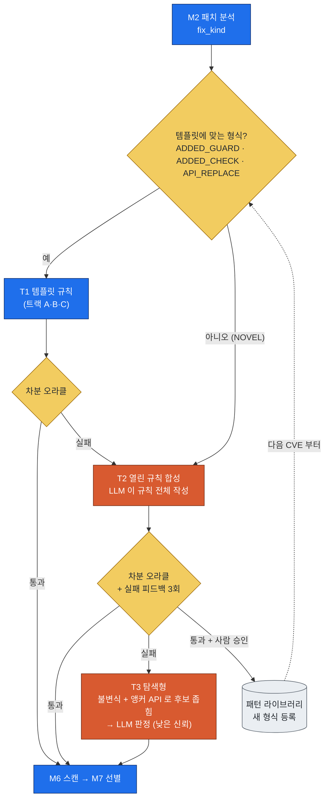

# 처음 보는 형식의 취약점에도 유사 결함을 찾는 구조 (v2.3 보강)

> 2026-11-23 · 김나연 · [scope-v2.3.md](scope-v2.3.md) 보강안 (팀 리뷰 후 확정)
> 요구: **새로운 형식의 취약점 패치가 나와도, 그 패치를 출발점으로 같은 결함이 남은 다른 코드를 찾을 수 있어야 한다.** 카탈로그·템플릿(트랙 A·B·C)에 없는 형식이라는 이유로 "범위 밖" 처리되면 안 된다.

---

## 1. 핵심 아이디어 — 유형에 의존하지 않는 오라클

v2.3 의 트랙 A·B·C 는 **미리 정한 형식**(권한 Guard, API 앞 검사, API 교체)에 맞을 때만 동작한다. 처음 보는 형식은 카탈로그도 템플릿도 없다.

하지만 어떤 형식이든 보안 패치는 **"패치 전 코드에는 있고 패치 후 코드에는 없는 성질"** 을 만든다. 그래서 다음 오라클은 취약점 유형과 무관하게 쓸 수 있다.

> **차분 오라클 (differential oracle):** 규칙 R 이 ① 패치 전 코드의 수정 지점을 잡고 ② 패치 후 코드의 그 지점은 잡지 않으며 ③ 패치 후 코드의 다른 곳(대조군)을 예산 이상 잡지 않으면, R 은 "이 패치가 고친 결함 구조"를 표현한 규칙으로 채택한다.

이미 M5 자가 검증(v2.1 R1)이 이 오라클이다. KNighter 도 LLM 이 합성한 체커를 **원본 패치로 검증**해 다양한 버그 패턴에 대응한다 [1]. 즉 형식이 새로워도 **규칙을 만드는 방법만 열려 있으면** 나머지 파이프라인(스캔·선별·검증 계층·대시보드)은 그대로 쓸 수 있다.

## 2. 3단 사다리 — 정해진 형식부터, 없으면 열린 합성, 그래도 안 되면 탐색



| 단 | 언제 | 규칙을 누가 어떻게 | 검증 | 결과 표시 |
| --- | --- | --- | --- | --- |
| **T1 템플릿** | 트랙 A·B·C 형식 | 고정 템플릿 + 파라미터 (seed → LLM 일반화) | 차분 오라클 | 일반 |
| **T2 열린 합성** | 템플릿에 없는 형식(`NOVEL`), 또는 T1 실패 | LLM 이 **규칙 전체**를 작성 (§3) | 차분 오라클 + 실행 결과 피드백 최대 3회 + 일반화 사다리(§4) | `rule_origin=synthesized` |
| **T3 탐색형** | T2 도 실패 | 규칙 없이: 패치에서 뽑은 **불변식**과 **앵커 API**(수정 지점이 쓰는 API·식별자)로 인덱스에서 후보 메서드를 좁히고, M7 검증 계층(질문 분해·근거 대조·교차 비판)으로 판정 | 근거 대조 필수, 사람 라벨 | `rule_origin=exploratory`, 낮은 신뢰, 지표 분리 |

**어떤 형식이든 최소한 T3 까지는 간다.** 그래서 "범위 밖" 은 diff 가 코드가 아닌 경우(리소스·설정만 변경)나 분석 불가 언어로 좁혀진다.

## 3. T2 의 규칙 언어 — Semgrep 규칙을 쓴다

T1 의 고정 템플릿(Tree-sitter `.scm` + 파라미터)은 정해진 형식만 표현한다. 처음 보는 형식을 LLM 이 직접 규칙으로 쓰려면 **표현력이 크고, LLM 이 잘 쓰고, Java·Kotlin 둘 다 되는** 규칙 언어가 필요하다.

| 기준 | Semgrep 규칙 (CE, 로컬 실행) |
| --- | --- |
| 표현력 | `pattern`, `pattern-inside`, `pattern-not-inside`, 메타변수, `metavariable-regex` 등으로 "이 호출이 이 검사 없이 나타남" 같은 구조를 바로 쓴다 [3] |
| LLM 이 쓰기 쉬운가 | Semgrep 스스로 규칙 문법이 LLM 친화적이라고 설명 [4]. 코드와 비슷한 패턴이라 diff 에서 바로 옮기기 쉽다 |
| 언어 | Java·Kotlin 모두 지원 [2] → v2.3 위험 K2(Kotlin) 도 T2 경로에서는 해소 |
| 한계 | CE 는 기본적으로 함수 단위 분석. 그래서 **Binder 진입점 도달성은 기존 M3·CallGraph 가 맡고**, T2 규칙은 함수 안 구조를 맡는다 (둘을 M6 에서 결합) |
| 보안 | 로컬 CLI 로만 실행, 계정·클라우드 기능 사용 안 함 (미공개 후보 외부 전송 금지 원칙 유지) |

**예 (T2 가 만들 수 있는 규칙, 🔶 예시):**

```yaml
# CVE-2024-0053 형태: 앱이 준 Icon 을 사용자 경계 확인 없이 돌려줌
rules:
- id: synth-uri-user-icon-return
  languages: [java]
  severity: WARNING
  message: 앱이 제공한 URI 아이콘을 사용자 경계 확인 없이 반환
  patterns:
    - pattern-inside: |
        $T $M(...) { ... }
    - pattern: return $X.getCustomPrinterIcon(...);
    - pattern-not-inside: |
        $I = $X.getCustomPrinterIcon(...);
        ...
        if (<... $I.getUri() ...>) { ... }
```

T2 는 처음엔 위처럼 **패치와 거의 같은 정확한 규칙(L0)** 을 만들고, §4 의 사다리로 일반화한다.

## 4. 일반화 사다리 — 가장 넓으면서 예산을 지키는 규칙을 고른다

새 형식은 "어디까지가 같은 결함인가" 의 기준이 없다. 그래서 일반화 수준을 단계로 만들어 **모두 차분 오라클에 돌리고**, 통과하는 것 중 가장 일반적인 것을 채택한다.

| 수준 | 무엇을 추상화 | 예 (위 규칙) |
| --- | --- | --- |
| L0 정확 | 없음 — 패치 코드 그대로 | `getCustomPrinterIcon` 반환 |
| L1 식별자 | 변수·필드 이름 → 메타변수 | `$X.$GETTER(...)` 중 반환 타입이 `Icon` |
| L2 API 계열 | 같은 역할의 API 묶음 | `Icon` 을 돌려주는 모든 getter / `Icon.loadDrawable` 계열 |
| L3 의미 | 결함 불변식 수준 | "앱이 준 URI 를 사용자 경계 확인 없이 시스템 권한으로 사용" |

- 각 수준의 `control_hits`(대조군 히트) 를 기록하고, `max_control_hits` 안에서 **가장 높은 수준**을 채택한다.
- 수준별 결과는 대시보드 D-5 에 모두 보인다. 분석가가 "더 좁게/넓게" 를 직접 고를 수 있다 (효용성).
- L3 는 규칙으로 쓰기 어려운 경우가 많아, 이때는 T3 탐색형의 불변식으로 넘긴다.

## 5. 패턴 라이브러리 — 새 형식이 들어올수록 도구가 넓어진다

T2 에서 채택된 규칙이 **사람 승인**(대시보드 라벨)을 받으면 새 패턴 유형으로 등록한다.

```yaml
# patterns/library/uri-user-icon.yaml  (🔶)
id: uri-user-icon
invariant: 다른 앱이 준 URI 기반 Icon 은 사용자 경계를 확인한 뒤에만 로드·반환한다
origin_cves: [CVE-2024-0053]
rule_levels: {L0: rules/CVE-2024-0053/synth-L0.yaml, L2: rules/CVE-2024-0053/synth-L2.yaml}
adopted_level: L2
approved_by: <라벨 작성자>
```

다음 CVE 가 들어오면 M2 라우팅(§2 의 "템플릿에 맞는 형식?")이 라이브러리도 함께 본다. 같은 형식이면 T1 처럼 빠르게 처리되고, 아니면 다시 T2 로 간다. Semgrep Assistant 가 사람의 분류 결정을 기억해 다음 분류에 쓰는 것과 같은 방향이다 [5].

## 6. 새 형식 대응력을 어떻게 증명하나 (M11, P0)

"처음 보는 형식에도 된다" 는 주장은 직접 재야 한다.

| 실험 | 방법 | 지표 |
| --- | --- | --- |
| **E1 미지 형식 모의 (hold-out)** | 기준선 CVE 를 처리할 때 **T1 템플릿과 패턴 라이브러리를 끄고** T2 만으로 처리 | 차분 오라클 통과율, T1 결과와 후보 겹침 비율 |
| **E2 실제 범위 밖 형식** | 표본에서 템플릿에 안 맞던 패치(조건 변경형·`OTHER`) 일부를 T2 → T3 로 처리 | T2 채택률, T3 후보의 사람 판정 TP 비율 |
| **E3 라이브러리 효과** | 같은 계열 CVE 를 시간순으로 넣으며 라이브러리를 켠/끈 결과 비교 (URI_USER 계열 5건) | 두 번째 CVE 부터의 처리 시간·LLM 호출 수·회고 적중 |

E1 이 "새 형식이 와도 같은 파이프라인이 동작한다" 를, E3 가 "쓸수록 넓어진다" 를 보여준다.

**주의 ([limitations.md](limitations.md) L3):** T2·T3 는 LLM 을 쓰므로, LLM 이 평가 대상 이후의 패치를 학습했을 가능성이 있다. E1~E3 결과에는 사용 모델의 학습 시점을 함께 적고, E3 의 회고 적중은 **라이브러리에 등록된 규칙을 고정한 채 LLM 없이 스캔한 결과**를 주 결과로 낸다.

## 7. 위험과 대응

| # | 위험 | 대응 |
| --- | --- | --- |
| N1 | LLM 이 쓴 규칙이 그럴듯하지만 틀림 | 채택은 차분 오라클만 결정 (LLM 판단으로 채택 안 함). 실패 피드백은 실행 결과만 [6] |
| N2 | 규칙이 패치에 과적합 (L0 만 통과) | 일반화 사다리 L1~L2 를 자동 시도, 결과를 수준별로 보여 분석가가 선택. L0 만 통과하면 `narrow` 태그 + T3 탐색 병행 |
| N3 | 규칙이 지나치게 넓음 | 수준별 대조군 예산 + M6 스캔 예산 (v2.1 R1) |
| N4 | T3 탐색형의 오탐 | 지표를 따로 집계, `exploratory` 배지, M7 질문 분해·근거 대조·교차 비판 필수, 상위 K 만 |
| N5 | LLM 호출·시간 증가 | T2 는 CVE 당 최대 (L0 1 + 실패 재시도 3 + 사다리 3) 회, T3 는 상위 K. `max_calls_per_cve` 초과 시 해당 단계 생략 |
| N6 | Semgrep 도입 부담 (5주차) | T1 은 기존 Tree-sitter 그대로. Semgrep 은 **T2 전용 실행기**로만 추가 (`ruleengine/semgrep_runner.py`: before/after/대조군 파일에 CLI 실행 → JSON 파싱). 파일 모드 오라클은 반나절 작업량 |
| N7 | Semgrep CE 함수 단위 한계 | 도달성은 M3·CallGraph 가 계속 담당, M6 에서 결합. 함수 경계를 넘는 형식은 T3 로 |
| N8 | 사람 승인 병목 | 라이브러리 등록은 선택. 승인 전에도 T2 규칙은 그 CVE 스캔에는 쓰인다 |

## 8. 모듈 변경과 일정

| 모듈 | 변경 | 우선순위 |
| --- | --- | --- |
| M2 | `fix_kind` 에 `NOVEL` 추가 (템플릿·라이브러리 모두 불일치), 앵커 API·불변식 후보 추출 | P0 |
| M5 | `synthesize_rule(client, patch, feedback)` (T2), `ladder(rule) -> [L0..L3]`, 공통 `differential_check(rule, before, after, control)` | P0 (L0·실패 루프), P1 (사다리) |
| `ruleengine/` | `semgrep_runner.py` 추가, T1 matcher 와 같은 `Match` 형식으로 변환 | P0 |
| M6 | T2 규칙 결과 + M3 도달성 결합 | P0 |
| M7 | `rule_origin` 별 점수·배지, T3 후보 처리 | P0 (배지), P1 (T3) |
| `patterns/library/` | 승인된 새 형식 저장, M2 라우팅이 참조 | P1 |
| M11 | E1 (P0), E2·E3 (P1) | |

| 주차 | 추가 작업 |
| --- | --- |
| 5주 | `differential_check` 공통화 (T1·T2 같은 오라클), `semgrep_runner` 파일 모드, CVE-2024-0053 으로 T2 L0 손 검증 |
| 6주 | `synthesize_rule` LLM 루프, E1 hold-out 1건 |
| 7주 | 일반화 사다리, T3 탐색형(시간 되면), 라이브러리 등록 흐름 |
| 8주 | E1~E3 결과 정리 → 발표 "새 형식 대응력" |

## 참고

- [1] C. Yang et al., "KNighter: Transforming Static Analysis with LLM-Synthesized Checkers," SOSP 2025. https://arxiv.org/abs/2503.09002 — 패치로부터 체커 합성, 원본 패치로 검증, 다양한 버그 패턴
- [2] Semgrep, "Supported languages." https://semgrep.dev/docs/supported-languages — Java·Kotlin
- [3] Semgrep, "Rule structure syntax." https://semgrep.dev/docs/writing-rules/rule-syntax — `pattern-inside`·`pattern-not-inside`·메타변수 연산자
- [4] Semgrep, "Announcing AI noise filtering and triage memories," 2025. https://semgrep.dev/blog/2025/announcing-ai-noise-filtering-and-triage-memories — LLM 친화적 규칙 문법
- [5] 위 [4] — 사람 분류 결정 기억
- [6] J. Huang et al., "Large Language Models Cannot Self-Correct Reasoning Yet," ICLR 2024. https://arxiv.org/abs/2310.01798
